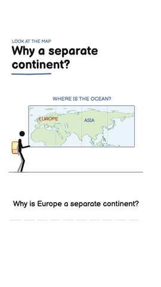
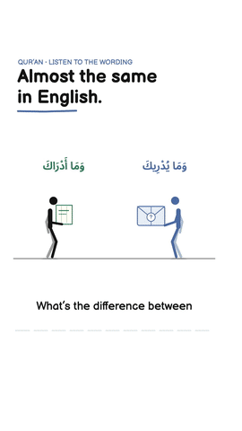

# Stick Figure Explainer

An agent skill for turning a topic into a narrated, hand-drawn vertical explainer—with purposeful stick-figure actions, captions, an editable preview and a finished MP4.

Built on [Kamran Ahmed's stick-scene](https://github.com/nilbuild/stick-scene), adapted from small website animations into a complete video-making workflow. The original runtime, license and example sources are included.

## Made with this skill

Animated previews are silent. Open the full narrated video for audio, or browse its editable source.

<table>
<tr><th>1 · Europe and Eurasia</th><th>2 · Quranic language</th></tr>
<tr>
<td align="center"><a href="examples/europe-continent/output/europe-continent.mp4"></a></td>
<td align="center"><a href="examples/adraka-yudrika-remake/output/adraka-yudrika-remake.mp4"></a></td>
</tr>
<tr>
<td><strong>Why is Europe a separate continent?</strong><br>66.52 seconds · English narration<br><a href="examples/europe-continent/output/europe-continent.mp4">Full narrated video</a> · <a href="examples/europe-continent/">Editable source</a> · <a href="examples/europe-continent/SOURCES.md">Research</a></td>
<td><strong>Wa mā adrāka and wa mā yudrīka</strong><br>91.82 seconds · English narration with Arabic quotations<br><a href="examples/adraka-yudrika-remake/output/adraka-yudrika-remake.mp4">Full narrated video</a> · <a href="examples/adraka-yudrika-remake/">Editable source</a> · <a href="examples/adraka-yudrika-remake/SOURCES.md">Research</a></td>
</tr>
</table>

The first example demonstrates a comparison visible from frame one, a floor map, a shared load, a pencil following a boundary, distinctive companions, readable labels and a closing question. The Quran example demonstrates question/answer timing, verified Arabic quotations and a wider range of physical actions. Both include narration, timed captions, editable scenes and the finished MP4. They are reference productions, not compulsory templates for every topic.

## Install the skill

```sh
npx skills add thiernoyunus/stick-figure-explainer --skill stick-figure-explainer
```

Or clone this repository into your agent's skills directory. For Codex, a manual installation is:

```sh
git clone https://github.com/thiernoyunus/stick-figure-explainer.git ~/.codex/skills/stick-figure-explainer
```

Previously named **Stick Reel**. Existing GitHub repository links redirect to the new name; install under the new name and refresh your agent’s skill discovery. Then ask:

> Use $stick-figure-explainer to make a narrated Reel explaining the difference between these two ideas. Let's agree on the script first.

The agent reads the creative guidance, chooses physical metaphors, prepares narration, draws the scenes, checks them and exports. It should preserve an approved script and your explicit creative choices.

## Set up the video tools once

From the installed skill/repository folder:

```sh
npm ci
npx playwright install chromium
```

You also need [Node.js 22 or later](https://nodejs.org/en/download) and [FFmpeg/FFprobe](https://ffmpeg.org/download.html) available on your command line. On Linux, Playwright may need its system packages: `npx playwright install --with-deps chromium`. Browser installation downloads Chromium. The package pins its tested Playwright version; its [browser setup guide](https://playwright.dev/docs/browsers) explains that matching requirement.

The tools default to Playwright's matching browser, rather than a hard-coded Mac location. If you intentionally use a different installed browser, set `PLAYWRIGHT_CHROMIUM_EXECUTABLE_PATH` to its executable. That override may have different compatibility limits.

The automated Linux check uses Ubuntu 24.04 with the pinned browser version; a newer distribution can need a newer Playwright release or different system packages.

## Try it without an API key

The supplied focus example includes narration. From this repository:

```sh
node scripts/render.mjs examples/focus
node scripts/preview.mjs examples/focus
```

Open the printed local address. Play with narration, pause, scrub, replay the current scene by clicking it, and toggle the text-safe-area guide. The video itself is a normal noninteractive MP4.

For a new project:

```sh
node scripts/new-project.mjs ../my-reel
# Edit ../my-reel/script.txt, scenes.js and content.json for your topic.
# Time the shots and captions to your actual recording, then import it:
node scripts/prepare-audio.mjs ../my-reel /path/to/recording.wav
node scripts/render.mjs ../my-reel --check
node scripts/render.mjs ../my-reel
```

Projects contain actual local files and can be moved independently of this repository. Initialization refuses to overwrite an existing folder. Audio import refuses to overwrite narration or cut off an overlong recording. Supply a recording from any voice tool; a paid service is not required. An optional Gemini adapter is documented in [audio.md](references/audio.md). Kokoro integration is deferred; it is not claimed as implemented in this version.

## Examples and visual vocabulary

- [Europe and Eurasia](examples/europe-continent/): the final map explainer shown first above, including research, an immediately visible opening map, centered Asia labels and a brimmed-hat companion.
- [Focus](examples/focus/): a general-purpose narrated example with editable source.
- [Rain in context](examples/rain-context/): held umbrella, rain, plant growth and contextual comparison.
- [Adraka and yudrika](examples/adraka-yudrika/): Arabic quotations and English explanations across several props.
- [Adraka and yudrika remake](examples/adraka-yudrika-remake/): the same script/voice with eleven physical-action scenes—unfolding, carrying, a lantern/backpack, a pulled month scroll, a telescope, a star chart and reading partners. The original cut remains available for comparison.
- [Original scene sources](examples/upstream/): the full original example collection, including carrying, throwing, catching, tools and robot collaboration.

The [example guide](references/examples.md) links preview images and explains what to borrow. The [creative guide](references/creative.md) covers script, layout, meaningful movement and review. Religious-source guidance is separate, so other topics don't inherit Quran-specific instructions.

The [two](references/actions-a.md) [action studies](references/actions-b.md) cover all 32 original registered scenes, with exact source references, selected detailed image checks and reuse cautions. The [four overview sheets](references/gallery/) show every original scene at three moments. They teach carrying, gripping, releasing, catching, cranking, hanging, peeling and coordinated responses—not a repeated walk-and-click routine. Original examples can contain limitations; inspect and recheck an adaptation rather than treating the gallery as a clean-motion guarantee.

The default is 1080×1920, white background and large scenes. The included safe rectangle is an editable organic-video working preset, not official ad certification. Guides and preview controls are excluded from exported video.

## What is checked

Full export checks every frame's actual painted text bounds, registered hand/prop contacts, recording duration and browser errors. It creates the MP4, captions, cover, contact sheet, safe-zone checking image and verification report. The native scene tools check movement separately. Inspect the images and listen to the finished video: automated checks do not establish factual accuracy, good storytelling or pronunciation.

```sh
npm test
python3 -m unittest discover -s tests -p 'test_*.py'
npm run test:smoke
```

The smoke test creates a fresh project in a folder with spaces, imports bundled narration, exports/decodes the video, checks narration playback, actual audio seeking and phone layout, and verifies that missed contacts and overflowing titles fail. It does not make paid API calls. See [project-format.md](references/project-format.md) for editing details.

## Credit and license

MIT, with the original stick-scene MIT notice retained. Bundled fonts retain their SIL Open Font License notices. See [THIRD_PARTY_NOTICES.md](THIRD_PARTY_NOTICES.md). This is an independent adaptation, not an official stick-scene release.
